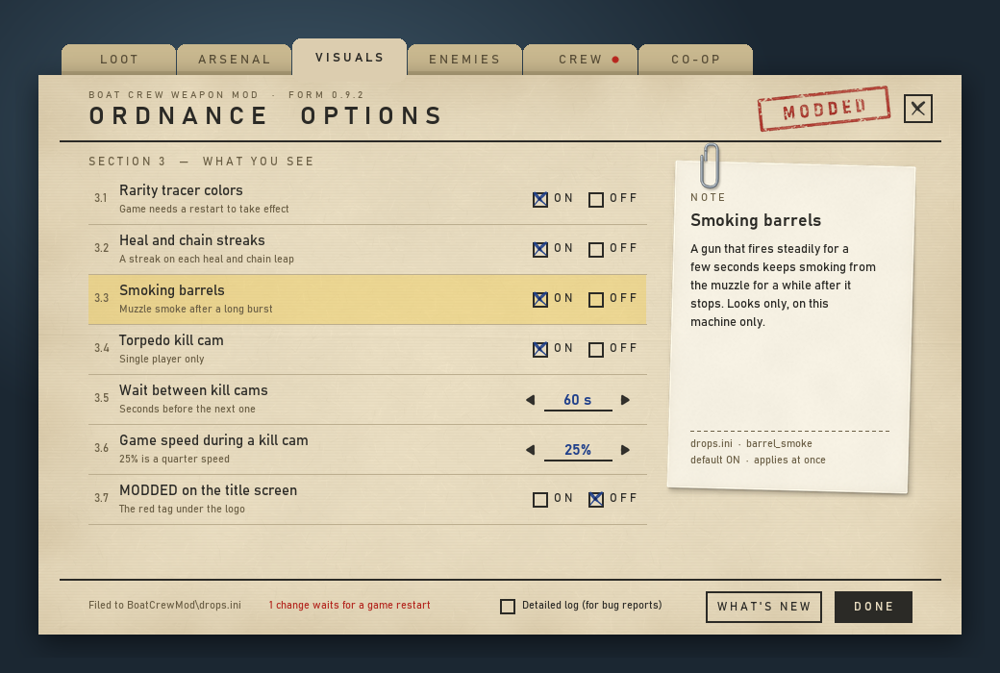
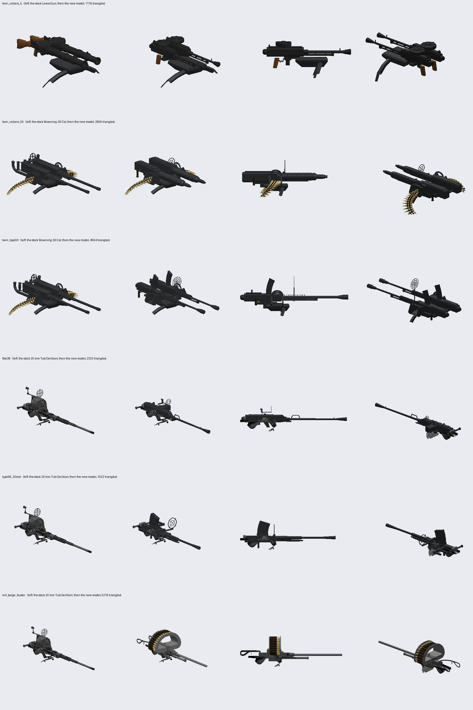
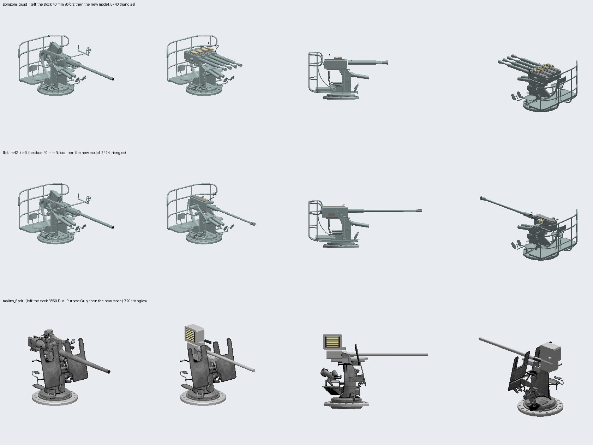
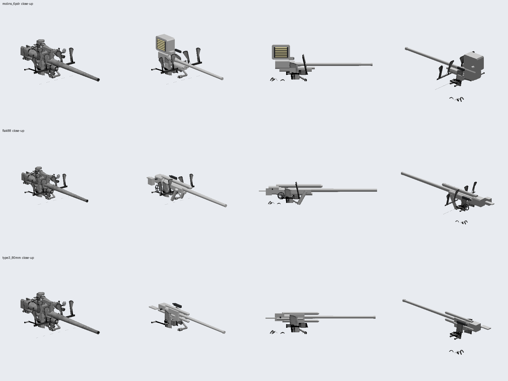
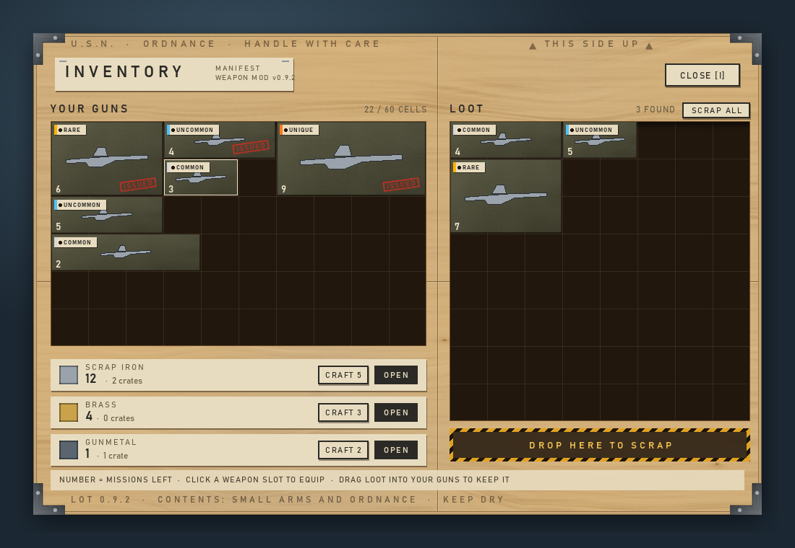
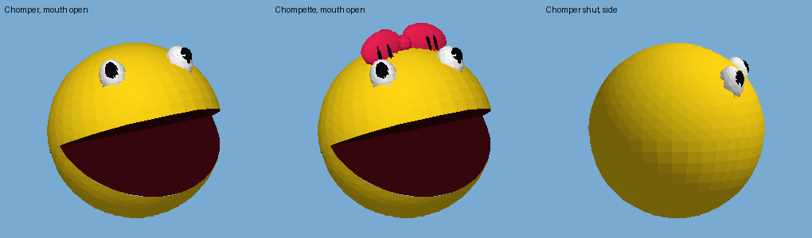
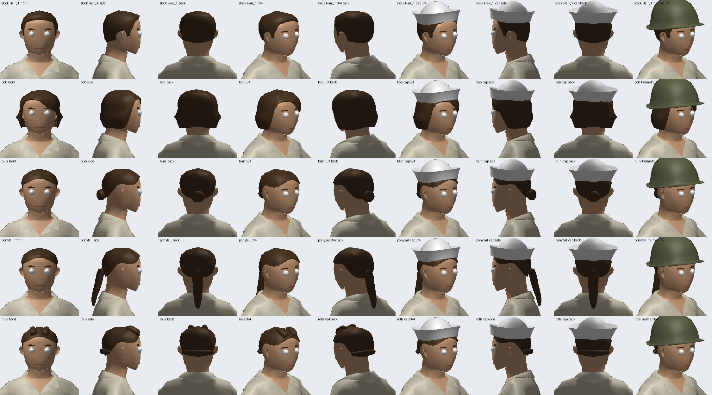

# Boat Crew Weapon Mod 0.9.8

**Random gun loot, new WW2 guns, tougher enemies and a crew with a story.**

A mod for [Boat Crew](https://store.steampowered.com/app/1633370/Boat_Crew/), the WW2 PT boat game on Steam.
Picking up RP crates sometimes gives you a **found gun**: a copy of a stock gun with random effects, in Common,
Uncommon, Rare or, very rarely, Unique. Keep the ones you like in a Diablo-style inventory, scrap the rest for
materials, and craft crates that open with a slot machine. The mod also adds dozens of period guns with their own
models, Rare and Elite enemy ships, and a crew that remembers its battles.

> **A personal project, still in testing.** I'm not associated with the developers or the publisher of Boat Crew, and
> they don't check or support this mod. Please don't send them bug reports while it is installed. Much of it has had
> only light testing, so read the [warnings](#warnings-please-read) before you install.

## Highlights

- **Found guns:** 1 to 3 random effects each (Homing, Chaining, Flak, Deadeye, Skipping, Drum and over 20 more), colored tracers by rarity.
- **Uniques:** named guns with fixed powers, one for nearly every gun, such as Hornet's Nest, The Ferryman and The Metronome.
- **Eleven more turret guns:** Twin Vickers K, Twin Type 93, 2 cm Flak 38, M4 Barge Buster, Twin DShK and more, each with its own model.
- **Forty-two side-grades:** the 8.8 cm Flak 36, Pom-pom, Chicago Piano, T-34 turret, Katyushas, Boys AT rifle and more.
- **Found torpedoes:** Seeking, Swift or Dolphin-leaping torpedoes, plus Uniques such as Chomper, a hungry yellow ball that chomps its way in.
- **Smoke pots and life rafts:** depth charge slot gear that lays a 150 m smoke screen or fetches your crew from the water.
- **Rare and Elite enemies:** tougher ships with traits such as Armored, Swift, Long Boi or Chonker, each carrying a guaranteed gun.
- **Torpedo kill cam:** slow motion follow-cam when one of your torpedoes is about to hit (single player).
- **Battle newsreel:** a black-and-white GIF of each battle's best moments, played on an old 1950s TV page in your browser.
- **Crew files and after-action reports:** every battle told as a story, a past for each crew member, a memorial for the lost.
- **Letters and talk:** letters home and mail call, crew lines over their heads in 8 personalities, closest mates and earned nicknames.
- **Female crew:** a quarter of the crew are women by default, with their own hair, figure and names.

## Pictures

Renders of the mod's models and windows, made outside the game (some from older versions).

| | |
|---|---|
|  |  |
| Mod Options window | New turret guns next to the stock ones |
|  |  |
| Side-grades: Pom-pom, Flak M42, 6-pdr Molins | The 8.8 cm Flak 36 |
|  |  |
| The inventory and loot grids | Chomper, a Unique torpedo |



## Quick start

1. Back up your saves (`<game folder>\Boat Crew_Data\GameData\GameSaves`).
2. Download the zip of the latest release from the
   [Releases page](https://github.com/davidnendza/boat-crew-weapon-mod/releases).
3. Close the game and unzip the zip into the Boat Crew game folder, next to `Boat Crew.exe` (Steam: right-click Boat Crew, Manage, Browse
   local files).
4. Start the game. The mod writes its settings and a log (`weaponmod.log`) into the `BoatCrewMod` folder.

See [Install](#install) for details and [Uninstall](#uninstall) before you remove it.

## Everything is optional

Nearly every part can be turned off or tuned. **Mod Options** on the title screen and the loadout screen has tabs for
Loot, Arsenal, Visuals, Enemies, Crew and Co-op. The same switches are in `BoatCrewMod\drops.ini`, for example:

- `crew_stories=0` turns off the after-action report, `crew_letters=0` the letters home and mail call, and
  `crew_talk=0` the crew's lines (the first two are new in 0.9.8).
- `female_crew` sets the share of women (default 25), and `no_females=1` turns them off completely.
- `newsreel=0` stops the battle filming, which can slow battles on some machines.
- `turret_guns=0` and `side_grades=0` hide the new guns; `killcam=0` turns off the kill cam.

Enemy traits are in `BoatCrewMod\enemies.ini`, and you can write your own guns in `BoatCrewMod\weapons.ini`.

## Co-op

Co-op works when everyone in the session has the same version of the mod. Found guns, side-grades, torpedoes and Rare
and Elite enemies are then shared. It has seen the least testing of anything here, and the crew attachments are
untested in co-op. Each part can be switched off; see the co-op warning below.

## Links

- [Boat Crew on Steam](https://store.steampowered.com/app/1633370/Boat_Crew/)
- [Boat Crew Discord](https://discord.gg/HXPHYXZjcv), run by the game's developers: news, the community, and where ideas for this mod come from
- [Releases](https://github.com/davidnendza/boat-crew-weapon-mod/releases) and [issues](https://github.com/davidnendza/boat-crew-weapon-mod/issues) for this mod

## Contents

- [What it does](#what-it-does)
- [Changes](#changes)
- [Warnings: please read](#warnings-please-read)
- [Install](#install)
- [Uninstall](#uninstall)
- [Settings (`BoatCrewMod\drops.ini`)](#settings-boatcrewmoddropsini)
- [Enemy settings (`BoatCrewMod\enemies.ini`)](#enemy-settings-boatcrewmodenemiesini)
- [Custom gun models (experimental)](#custom-gun-models-experimental)
- [Reporting problems](#reporting-problems)
- [Source and license](#source-and-license) (forks and pull requests welcome)

## What it does

- **Crew attachments (new in 0.9.5, initial version).** Your crew remember their battles, have a past, write and get
  letters, and talk. This is the initial version of the crew attachments feature; more is coming for it.
  - **After-action report.** After every battle a sheet on the after-battle screen tells the battle as a story: a
    summary, then a paragraph for each crew member of your boat (hits with where, by what shell and which enemy gun and
    ship, wounds, downs, overboard, pick-ups, deaths, kills and shared kills). It opens by itself once per new report;
    the REPORT tag opens it again. Scroll with the mouse wheel; DONE or Esc closes it. The stock screen under it takes
    no clicks while it is open. Each report is also added to `BoatCrewMod\crew-reports.txt` (over 2 MB it moves to
    `crew-reports.old.txt`).
  - **Crew files.** A CREW FILES tag on the crew screen opens a file cabinet. The CREW tab lists everyone with at least
    one battle on file; THE LOST tab lists the dead, missing and captured. A file shows the portrait, status, lifetime
    tallies and every battle's report, newest first. It opens on the crew member the crew card was showing.
  - **A past.** Each crew member on file gets a hometown, a job before the war, a keepsake, a plan for after the war and
    next of kin, rolled once and shown under PERSONAL with their personality. The game's own traits steer it (Has
    Kids, Orphaned, Drunkard, ...), and nobody aboard shares a home, job, keepsake or plan. All of it is invented; the
    game has no such data.
  - **The lost.** A lost crew member's file shows IN MEMORY (or PRISONER OF WAR): their service, their effects returned
    and what they were going to do, with a KIA, LOST or CAPTURED stamp on the photo. Only crew who fought at least one
    battle with 0.9.5 have a file, so crew lost before that are not listed. A missing or captured crew member who comes
    back leaves THE LOST.
  - **Letters home.** When you lose crew, the letters open after the report (or from the LETTERS HOME tag, or WRITE TO
    THE FAMILY on the report) with a draft to each family from the file. Pick THE TRUTH or SPARE THEM, OTHER LINES for
    other wording, then SIGN, or SIGN ALL when there are several, so a sinking is one click. LATER leaves it; an
    unsigned letter can be written from the crew files (WRITE THE LETTER). Signed letters stay in the file.
  - **Mail call.** Every few battles (never after the first) MAIL CALL opens after the report and the letters home, with
    letters from home for 2 or 3 of the crew who fought: family, sweethearts and friends whose stories go on over
    several letters. Mail for a lost crew member comes back marked returned, missing or forwarded. Letters show under
    LETTERS FROM HOME in the crew file.
  - **Talking crew.** Crew say short lines in bubbles over their heads: when hit, after a kill, when a crewmate goes
    down, dies or goes overboard, at a fire, and in quiet moments about home, their letters and the crew they lost,
    often with a reply. Each has one of 8 personalities (joker, stoic, crazy, silent, hothead, worrier, professional,
    cheerful), steered by traits. During a gunfight someone speaks every 9 to 19 s at the normal setting, in line with
    their job, and the crew shout when a burst rakes the deck. In the first battle after you lose crew, those who were
    there hold a roll call, and the lost names are met with silence. Only crew who knew the dead mourn them.
    `crew_talk=0` silences them; `crew_chatter` sets how often they talk (Mod Options, Crew tab).
  - **Crew bonds (new in 0.9.6).** Each crew member's closest mate is worked out from their shared battles, manning
    the same gun, shared kills, sinkings and swims together. The closest mate is named in the crew file ("Closest
    aboard"), on the memorial and in the letter home. Close mates talk to each other in quiet moments and in battle
    chatter. When a man falls, his closest mate speaks first and grieves him most afterwards. Bonds start counting
    from the first 0.9.6 battle, so veteran crews have no close mates at first.
  - **Nicknames (new in 0.9.6).** Crew earn one of 13 nicknames from their record: Jonah (lost at sea and picked up),
    Lazarus (went down twice and got back up), Lucky, Stitches, Slick, Plank Owner, Doc, Chips, Wheels, Mule,
    Scrounger, Trigger and Splinters. Offers show on the after-action report with KEEP and VETO, at most 3 waiting. A
    vetoed name is never offered to that man again. A kept name shows on the crew card, in the crew file and in the
    report heading from the next battle on, and is used in the talk, the roll call, the memorial and the letter home.
  - **The dead man's station (new in 0.9.6, not tested in game yet).** When a crew member lost in the last 3 battles
    is replaced at his gun or job, the after-action report tells it once, and the new man may speak about taking over
    his station.
  - **Fewer repeated lines (new in 0.9.6).** A line naming a crewmate is used once a battle, and last battle's lines
    are only said again when nothing else fits. That memory is kept in `BoatCrewMod\talk-last.txt`, so it holds
    across restarts.
  - **Where it is kept.** The crew files are in `BoatCrewMod\crew-files.ini`, and each game save gets its own copy in
    `BoatCrewMod\saves` (a `.crew` file beside the inventory copy), so loading a save brings its crew files back. Saves
    from before 0.9.5 and new campaigns start with empty files. Before loading another save's files the mod backs up
    the current ones to `BoatCrewMod\saves\backup` (crew-*.ini, the newest 20). A battle during which you load a save
    or start a campaign is not filed. The raw data of the last 50 battles is kept in `BoatCrewMod\battles`.
  - **Your own wording.** `reports.default.ini`, `life.default.ini` and `talk.default.ini` in `BoatCrewMod` show the
    built-in text of the reports, the crew's past, memorials and letters, and the crew's lines (written each session,
    the first time the mod needs them). Copy a section into `reports.ini`, `life.ini` or `talk.ini` and change it
    there; it replaces the built-in one. `reports.ini` is read for every report; `life.ini` and `talk.ini` take effect
    at the next launch. Letters from home cannot be changed yet.
  - **Limits.** Your own boat only, and untested in co-op. The talk (`crew_talk`), the report (`crew_stories`, since 0.9.8)
    and the letters and mail (`crew_letters`, since 0.9.8) can be switched off; the crew files are always kept. A portrait can show NO PHOTO. Two crew with the same name, eyes and brows share
    one file.
- **Battle newsreel (new in 0.9.6).** A second camera films the best moments of each battle and, when the battle
  ends, writes them as a black-and-white, old-film-style GIF (640x360, 20 frames a second, up to about 60 s) to
  `BoatCrewMod\newsreels\newsreel_<date>_<time>.gif`. It films planes going down (a chase camera follows the
  falling plane), enemy ships sinking (circling at a distance that fits the ship, until it goes under), planes swooping
  in close, and your own crew on deck while your guns fire: gunners from over the shoulder, ammo runners from behind.
  At most 5 plane falls are filmed a battle, so planes do not fill the whole film. Night battles get automatic
  exposure, and the deck camera rolls with the boat.
  - **Newsreel TV.** `BoatCrewMod\newsreels\Newsreel TV.html` plays your newsreels in a web browser on an old 1950s
    wooden TV set, with a channel knob, a TV listings card, a power knob and snow and hiss between channels. The mod
    writes it again after every new film and at launch.
  - **Disk and memory.** Each GIF can be up to about 80 MB. `newsreel_keep=10` keeps the newest 10 (up to about
    0.8 GB) and deletes the oldest after each new film. Only files named exactly like the mod's own
    (`newsreel_<date>_<time>.gif`) are ever deleted, so rename or move a film to keep it. During a battle the film
    takes up to about 300 MB of memory.
  - **Switching it off.** Filming can slow battles. Battle newsreel GIF in Mod Options, Visuals tab, or `newsreel=0`,
    turns it off, also in the middle of a battle.
- **Found guns.** When you pick up RP crates, each pickup burst has a 40% chance to give a drop (`chance` in
  `drops.ini` or Mod Options). A found gun is a stock gun with 1 to 3 good effects, shown in color: faster fire, more
  damage, bigger blast radius, bigger magazine, faster reload, faster shells, fat tracers and the special effects
  below. Now and then (15%) a gun also gets a drawback such as jamming or a smaller magazine, on top of its effects,
  which then roll stronger.
  Uncommon guns fire blue tracers, Rare guns gold, Unique guns orange. Drops only roll guns for slot types your current
  boat has, so big-boat guns such as the 5-inch only start dropping once you sail a boat that can mount them.
- **RP cost.** A found gun costs the same RP as the stock gun it is based on, and like any gun it ties up that RP only
  while it is equipped. Change it with `price_scale` in `drops.ini` (`0` makes found guns free, as before 0.7.0).
- **Which guns.** Machine guns, 20 mm, 37 mm, Oerlikons, Bofors, Chopper, Elco, 3-inch and 5-inch, and since 0.5.0
  also rockets (Mousetrap, X50, Mk50, Mk50 Modded), utility guns (60 mm and 107 mm mortars, 75 mm howitzer) and crew
  weapons (BAR, Bazooka, handheld M1919, grenade launcher), and since 0.9.1 torpedoes (see Found torpedoes below).
- **Special effects:**
  - **Automated**: the gun aims and fires on its own with no gunner, with a 25% wider spread. On a utility gun (37 mm,
    mortar, howitzer) you no longer aim it: it fires at targets your boat has spotted, out to about 3 km.
  - **Short-handed**: needs one fewer gunner, at a lower fire rate (guns with 2 gunners only).
  - **Deadeye**: a chance for each shot to hit for x3 damage (direct hits; blast damage is not multiplied, so not on the
    howitzer).
  - **Salvager** (of Salvage): kills refill part of the gun's ammo.
  - **Vampiric**: kills repair your most damaged hull part a little.
  - **Bounty** (of Bounty): ship kills pay extra RP (not planes).
  - **Flak** (cannons and mortars): shells burst near the target, with a bigger blast. Best against planes.
  - **Skipping**: shots that hit the water skip off it once and keep flying.
  - **Shrapnel** (of Shrapnel, cannons from 37 mm up, mortars and rockets): exploding shells burst into a spray of bullets.
  - **Homing**: slower shells that steer into what they were fired at, moving ships included. Shots you aim yourself
    lock onto the enemy nearest their path, or, for mortar rounds, the one nearest where they come down.
  - **Chaining**: a hit can leap to another nearby ship (50-75% of the time), and on again, each leap less likely and for
    half the damage. On guns you aim yourself, a shot that comes down next to an enemy counts as a hit.
  - **Guided** (rockets and the howitzer): shots steer onto their target.
  - **Bold**: bigger shots that are easier to land.
  - **Cheap** (of Cheapness): costs 40-70% less RP, but lasts a third fewer missions.
  - **All-Knowing** (utility guns and rockets): while you aim it, your crew fires at every enemy in sight, marked or not.
  - **Marking**: its hits mark a ship for 8 seconds; while marked, all your guns do 15-30% more damage to it. Marked
    ships get a red tag with the bonus and the seconds left.
  - **Giant Slayer** (of Giants): +40-80% damage to Rare and Elite ships.
  - **Opening Salvo** (Ambushing): +60-120% damage for the gun's first magazine each battle (until it first reloads,
    but at least 6 shots, so mortars and other one-round guns get six boosted rounds).
  - **Close Quarters** (Brawling) / **Long Shot** (of the Long Shot): +30-60% damage on hits within 400 m, or
    +30-70% on hits beyond 1000 m. A gun never has both. Neither rolls on crew weapons (they only fire within 270 m),
    Close Quarters not on mortars, and Long Shot not on the short-range tub machine guns (Lewis, Vickers K, M1919) or
    the Mousetrap.
  - **Overkill** (of Overkill): when it sinks a ship, 50-100% of the damage it had left over hits the nearest other
    enemy (within 300 m). In co-op only for the host.
  - **Veteran's**: the first gunner who kills with it makes it theirs: +3-6% damage per kill they score with it (up
    to 10 kills) while that gunner mans it. Kept with the gun; lost if that crew member dies, goes missing or is captured.
  - **Rallying**: its kills give your downed crew 5-12 seconds more before they bleed out.
  - **Sure-Footed**: each hit it lands on a ship steadies your crew: 4-8% less chance per hit (up to 10 hits; one
    hit's worth fades every 3 seconds) that a hit on your boat throws one of them overboard.
  - **Frugal** (of Economy): a 15-35% chance that a shot uses no ammo.
  - **Drum** (of the Drum): two to three times the magazine, but reloads 30% slower. On the machine guns (tub guns,
    Meat Chopper, BAR, Thompson, Johnson, handheld M1919) and the Oerlikon, Elco, Bofors and 37 mm autocannons.
  The damage effects above count blast damage too, not only direct hits, and multiply with each other (they stack).
  Since 0.9.8 the conditional bonuses (Giant Slayer, Opening Salvo, Close Quarters, Long Shot, Veteran's) add up
  instead, capped at +200% together.
  Drawbacks can also be **Wild** (+20-40% damage but a 50-100% wider spread; not on Homing or Guided guns, mortars
  or howitzers) or **Brittle** (the gun takes 50-100%
  more damage when hit).
  Some guns also get one **cosmetic** extra (30% by default): a tracer color (green, purple, cyan, orange, pink or
  white), long tracers, or an oversized or compact gun. Cosmetics are looks only: they do not count toward rarity.
  About a third of found guns also come in a **paint scheme** of the period (Haze Grey, Ocean Grey, Measure 21 Navy
  Blue, Deck Blue, Olive Drab, Kure Grey and more), named on their Look: line. Uniques are always painted gold.
  Paint is looks only too, and torpedoes keep their own colors.
- **Uniques.** About 1 drop in 25 (more from better crates) is a named Unique with a fixed set of powers, shown in
  orange. There is one for nearly every gun, among them:
  - **Hornet's Nest** (M2 Browning): shots seek their target, 80% of hits leap on to another ship, +25% fire rate.
  - **Lazarus** (37 mm AT): kills refill all its ammo and repair half of your most damaged hull part; reloads twice as
    fast.
  - **The Ferryman** (Bofors): very slow shells that home in and never run out of range, +250% damage, double blast.
  - **The Metronome** (Twin Oerlikon): every 3rd shot is a x4 critical hit, +50% fire rate and magazine.
  - **Hailstorm** (Mk50 rockets), **Old Reliable** (BAR), **Buzzsaw** (Meat Chopper), **The Verdict** (5-inch),
    **Rainmaker** (107 mm mortar), and one for every one of the mod's turret guns and side-grades (Chatterbox, Kurogane,
    Chicago Piano, The Admiralty, Elephant Gun, Tankograd, Acht-Acht, Stalin's Organ, The Ping and more).
  - **Chomper**, **Chompette**, **Flying Fish** and **Sneaking Eel** (torpedoes): see Found torpedoes.
  Scrapping a Unique gives 2 Gunmetal.
- **Found torpedoes (new in 0.9.1).** Torpedoes drop too, for the PT boats' torpedo tubes and the sub chaser's side
  launchers (Mk 13, 14, 18 and 24 for the standard tubes, Mk 8, 15 and 24 for the rear ones, the Mk 24 pair for the
  sub chaser). A found torpedo fits every slot type whose stock list has its torpedo (since 0.9.5: a Mk 8 found for a
  rear slot also fits a front slot that takes the Mk 8), takes a 4x1 space in the inventory and wears like a gun. Torpedo effects: **Heavy** (warhead damage), **of Thunder** (blast radius), **Swift** (engine thrust),
  **of the Long Run** (range), **Proximity** (goes off farther from a hull), **Seeking** (steers onto the nearest big
  ship ahead, or dives onto a submarine below; new in 0.9.2), **of the Dolphin** (leaps out of the water every few
  seconds with a splash, and runs faster) and **of Thrift**; drawbacks are Sluggish, Short Run and Dud Warhead. As in the game itself, torpedoes only hit the bigger
  ships: patrol boats, gunboats, armored boats and landing craft are too small, so homing torpedoes and the kill cam
  leave them alone. Torpedoes get no kill credit in the game, so on-kill effects do not exist for them. On a boat
  with torpedo slots, about 1 drop in 40 is a torpedo (`torpedo_share`).
  - **Chomper** and **Chompette** are Unique homing torpedoes that ride the waves as a hungry yellow ball (Chompette
    wears a bow), chomping all the way to the ship with their own sound. A Chompette prefers a ship no other homing
    torpedo is after. `chomp_volume` in `drops.ini` sets their volume (0 to 2).
  - **Flying Fish** (Unique, Mk 13 for the PT tubes, Mk 24 pair for the sub chaser) skips across the surface as a
    flying fish, wing fins out, and is much faster (+80% thrust and top speed, +25% warhead damage), but every ship spots it
    coming, so enemy ships can steer away from it. Only its look skips: it hits the same ships any torpedo does.
  - **Sneaking Eel** (Unique, Mk 14 for the PT tubes, Mk 24 pair for the sub chaser) is never spotted, so no ship
    steers away from it. It crawls along the surface as a commando in a red headband, hits harder (+50% warhead
    damage) and is a little slower (-15% thrust and top speed).
- **Torpedo kill cam (new in 0.9.1).** When one of your torpedoes is about to hit a ship, the camera follows it in slow
  motion (single player only). `killcam=0` turns it off; `killcam_cooldown` and `killcam_slow` tune it.
- **Crew weapon looks (new in 0.9.1).** Your crew's handheld weapons are easier to follow:
  - **Red tracers** (`crew_tracers`): shots from the BAR, handheld M1919, Thompson, Johnson and Boys fly red tracers.
    The Bazooka's rockets and the grenade launcher's grenades keep their look, and a found crew weapon with a rarity or
    cosmetic tracer color keeps that color.
  - **Marker** (`crew_marker`): a square over a crew member who is aiming. It is dim while they aim, turns bright red
    once they are ready and flashes yellow on each shot.
  - **Aim line** (`crew_aim_line`): a line from the crew member's weapon to their target, dashed while they aim, solid
    once they are ready, bright on each shot.
  All three are on by default and show on your own boat in battle only. Each can be switched off in **Mod Options**
  (Crew Weapons) or in `drops.ini`. Crew only fire at enemies within 270 m (the game's own rule), so the marker and
  line only appear when a target is that close. `weaponmod.log` lists what your crew aimed and fired at, with a
  summary after each battle.
- **Female crew (new in 0.9.3).** A quarter of the crew are women by default (`female_crew`), enemy crews too, with
  their own hair, a female figure that their clothes follow, and women's first names for new recruits. Each crew
  member's gender is stored in the save. "I don't want females!" in Mod Options (`no_females=1`) turns women off.
  Players without the mod see men. See Changes 0.9.3 for the details.
- **Rare and Elite enemies.** Now and then an enemy ship spawns as **Rare** (blue name tag, one trait) or **Elite**
  (gold, 1.75x HP and two or three traits). A tag over the ship shows its name and traits, and the kill feed announces
  it when it appears. Traits:
  - **Armored** (2x HP), **Swift** (faster), **Hard-Hitting** (its shots do +50% damage), **Loaded** (+100 RP when
    sunk), **Ironclad** (Elite only: 3x HP, a little slower).
  - Size traits: **Long Boi** (longer and tougher), **Short King** (shorter and faster), **Thicc** (wider, tougher,
    slower), **Noodle** (thinner and faster), **Chonker** (bigger all over) and **Smol** (smaller all over, faster).
  Sinking one drops a gun into your loot grid (Rare: Uncommon or better, Elite: Rare, and since 0.9.8 sometimes a Unique) and gives extra call-in progress
  (twice a normal kill for a Rare, three times for an Elite). About 8% of enemy ships are Rare and 2% Elite; every
  number and trait is in `BoatCrewMod\enemies.ini`.
- **Wear.** A found gun lasts a few missions. Each slot it is equipped in uses one mission in a battle where it fires; a gun
  that never fired (say the AI sank everything first) costs nothing. A worn-out gun
  is removed from your boat at the next port visit and gives the same material as scrapping it would.
- **Inventory window.** On the loadout screen, press **I** or click **Inventory**. It has a Diablo-style grid for your
  guns and a loot grid for new drops. Drag guns to keep, rearrange or scrap them (drop them on the striped box). Hover
  over a gun for its stats. You can drag the window by its top band. Each gun shows its rarity as a colored tag,
  its missions left as a number, and a red ISSUED stamp when it is on your boat. **SCRAP ALL** scraps everything in the
  loot grid except Uniques; click it again (CONFIRM) within 3 s.
- **Equipping a found gun.** The inventory window only keeps and sorts guns. To equip one, click a weapon slot on the
  loadout screen (for example Heavy Weapon Fore); found guns are in that slot's gun list with colored names (grey,
  blue, gold or orange by rarity). A found gun appears in every slot type whose stock list has its base gun (since
  0.9.1: a found Bofors fits Heavy and Heavy+ slots, as the stock Bofors does), and it can be equipped in two slots at
  once.
- **Workshop and crates.** Scrapping gives Scrap Iron, Brass or Gunmetal by rarity. Materials craft Iron, Brass or
  Gunmetal crates; better crates give better guns. Crates also drop sometimes. Opening one plays a three-reel slot
  machine.
- **Eleven more turret guns.** The PT boat's turret slots (Left and Right Turret) only had four guns, so the mod adds eleven
  more from the period (the last five are new in 0.9.7 and only minimally tested), each with its own model built from the game's own parts and paint. They are always in the
  turret slot's gun list, like the stock guns, and never wear out:

  | Gun | RP | Next to | How it plays |
  |---|---|---|---|
  | Twin Vickers K | 1,500 | M1919 | British .303. Much faster fire, lighter rounds, shorter reach: best up close |
  | Twin Vickers .50 | 2,500 | M2 | British, water-cooled. Faster than the M2 with more belt, but softer and shorter-ranged |
  | Twin Type 93 | 3,500 | above the M2 | Captured Japanese 13.2 mm. Heavier rounds and longer reach, 30-round boxes |
  | 2 cm Flak 38 | 4,500 | Oerlikon | German 20 mm. Faster action and faster shells, but 20-round magazines |
  | Type 96 25 mm | 6,000 | above the Oerlikon | Captured Japanese 25 mm. A heavier shell and bigger burst, slower, 15-round boxes |
  | M4 Barge Buster | 7,500 | top | A 37 mm cannon from a crashed P-39, as PT crews did on Guadalcanal. Slow, hits like a hammer |
  | Breda 20/65 Mod. 40 | 4,000 | Oerlikon | Italian 20 mm. 12-round strips: fewer shells, but truer aim, slightly harder hits, longer reach |
  | Madsen 20 mm | 4,000 | Oerlikon | Danish 20 mm. A 40-round drum, a little slower, more accurate, faster shells, longer reach |
  | Polsten 20 mm | 2,700 | Oerlikon | The budget Oerlikon: same rate and 30-round box, a little less accurate, slower reload |
  | Twin MG 34 | 1,200 | Lewis | German. Faster fire from 150-round drums, but less accurate, shorter-ranged and slow to reload |
  | Twin DShK | 2,000 | M2 | Soviet 12.7 mm. Cheaper and each round hits harder, but 30-round belts and less accurate |

  They sound like the guns they are, using the game's own sounds: the Vickers K fires with the Japanese 7.7 mm
  machine gun's sound, the Type 93 with the Japanese armored boats' machine gun, the Type 96 with the enemy's own
  25 mm, and the M4 with your utility slot's 37 mm M4. The Vickers .50 and the Flak 38 keep the M2's and the
  Oerlikon's, the closest the game has. The Twin MG 34 fires with the US .30 aircraft gun's sound and the Twin DShK
  with the Japanese 12.7 mm aircraft gun's; the Breda, Madsen and Polsten keep the Oerlikon's. `turret_guns=0` in
  `drops.ini` hides them.
- **Smoke pots and life rafts for the depth charge slots (new in 0.9.4, suggested by Reiver).** Always in the list of the PT
  boats' depth charge slots (Smoke Pot, Life Raft), the sub chaser's K-guns (x2) and stern racks (x4), and the PT-6's
  depth charge slot (x2, x3 or x4, since 0.9.5, not tested in game yet), like stock gear. They roll off the side or the stern exactly like depth charges. When one lands on the water:
  - **Smoke Pot** (200 RP each): floats and burns on the water where it lands. Every 12 seconds it puffs five
    clouds (the smoke artillery's cloud on itself and to both sides, smaller ones further out) that overlap into a
    screen about 150 m across. Most enemy ships cannot spot you through it. It burns for 150 seconds (`smoke_seconds`
    in `drops.ini`) and the last clouds linger about 40 seconds more. The smoke should show for co-op partners too
    (not tested yet). The game has only so many smoke clouds: one pot gets a full screen, several burning at once
    share them and come out thinner, and a third is always kept free for your own smoke shells.
  - **Life Raft** (300 RP each): heads for the nearest of your crew in the water (8 m/s, `raft_speed` in `drops.ini`)
    and picks them up. They are safe and back with your crew after the battle, but out of this one. A raft stays out
    for 3 minutes and picks up everyone it reaches. It only picks up your own crew, not stranded survivors from a
    mission or your co-op partners' crew.
  - **Life Rafts L + Smoke Pots R** (250 RP each): both on one boat. The left launcher drops life rafts and the right
    one smoke pots, so each fire button always drops the same thing. Offered as 1 + 1 on the PT boats' depth charge
    slots, 2 + 2, 3 + 3 and 4 + 4 in the PT boats' torpedo slots, 2 + 2 and 4 + 4 on the sub chaser's K-guns, 2 + 2, 3 + 3 and
    4 + 4 on the PT-6's depth charge slot, and 4 + 4, 6 + 6 and 8 + 8 on the sub chaser's stern racks.
  Otherwise the left and right launchers always carry the same choice; that is how the game links them.
- **Forty-two side-grades for the other slots (new in 0.9.0; the 8.8 cm Flak 36 is new in 0.9.6; 23 more are new in
  0.9.7 and only minimally tested: T-34 Turret 76 mm to Type 89 Knee Mortar in the table below).** Period guns that trade against a stock gun of the same
  slot, each with its own model on the stock gun's mount. Like the turret guns they are always in the slot's gun list,
  never wear out, and also drop as loot with random effects. A side-grade only shows in a slot that has its stock gun.
  Prices are relative to that stock gun:

  | Gun | Slots | Trades against | Price | How it plays |
  |---|---|---|---|---|
  | QF 2-pdr Pom-pom | Heavy, Heavy+ | Bofors | +20% | Quad mount: twice the fire rate, 14-round belt, but scattered, slower shells |
  | 3.7 cm Flak M42 | Heavy, Heavy+ | Bofors | same | Faster fire, 8-round clips, lighter shells: better against planes |
  | QF 6-pdr Molins | Heavy, Heavy+ | 3-inch | +15% | Autoloader: faster fire, flatter shells, far less blast |
  | 8.8 cm Flak 36 | Heavy, Heavy+ | 3-inch | +50% | The 88: heavier shell, bigger blast, longer reach, three rounds a load, fewer shells carried, slower rate |
  | Type 96 25 mm Triple | Heavy, Heavy+ | Twin Oerlikon | +25% | Three barrels and heavier shells, but scattered and shorter-ranged |
  | 2 cm Flakvierling 38 | Heavy, Heavy+, Medium | Elco Thunderbolt | same | Slower, but faster shells, tighter aim, bigger magazine; gun shield since 0.9.6 (looks only) |
  | T-34 Turret 76 mm | Heavy, Heavy+ | 3-inch | -40% | A tank turret: six ready rounds, but a slower shell, shorter reach and slightly slower fire |
  | 1.1-inch Chicago Piano | Heavy, Heavy+ | Dual Bofors | -30% | Quad 1.1-inch: faster fire from 32-round loads, but small shells with little blast, shorter reach |
  | QF 2-pdr Single | Heavy, Heavy+ | Bofors | -15% | A 56-round belt, but slower fire, softer and slower shells, a long re-belt |
  | 3.7 cm SK C/30 | Heavy, Heavy+ | Bofors | -40% | Very slow, 2-round loads, but very accurate, with fast, flat shells and a longer reach |
  | Breda 37/54 Twin | Heavy, Heavy+ | Dual Bofors | -20% | Slower and a little softer, but steadier, with a quick reload |
  | 8 cm Type 3 | Heavy+ | 3-inch | +35% | A heavier, faster shell at a slightly slower rate |
  | 10 cm Type 98 Twin | Heavy+ | 5-inch | +40% | Four shells a load and a very long reach, lighter shells, long reload |
  | QF 4.7-inch Mk IX | Heavy+ | 5-inch | same | Three rounds to the 5-inch's two, faster shells, smaller blast |
  | 10.5 cm SK C/32 | Heavy+ | 5-inch | -45% | Far cheaper with a faster shell, but a softer hit and a smaller blast |
  | 155 mm M1 Long Tom | Heavy, Heavy+ | 3-inch | +250% | One huge, fast shell at a time with a massive blast and the longest reach, then a long reload |
  | Type 96 25 mm Twin | Medium | Twin Oerlikon | +10% | Heavier shells, a bit slower and less accurate |
  | MG 151/20 Drilling | Medium | Twin Oerlikon | +20% | Three cannon: much faster fire and a bigger burst, but scattered, short reach, slow reload |
  | M1 81 mm Mortar | Utility | 60 mm mortar | +30% | Much bigger blast, fewer rounds, slower reload |
  | M18 57 mm Recoilless | Utility | 37 mm AT | +25% | Hits much harder with a bigger blast, slow shell, long reload |
  | Type 92 70 mm | Utility | 75 mm howitzer | -15% | Smaller blast, much faster reload, more shells |
  | Holman Projector | Utility | 60 mm mortar | -70% | Reloads twice as fast, but a small bomb: weak blast, 500 m reach |
  | 7.5 cm Pak 40 | Utility | 75 mm howitzer | +35% | A fast, flat shell that hits hard, but a small burst and a slower reload |
  | 45 mm 21-K | Utility | 37 mm AT | +10% | A much wider burst, but a bit softer and slower, slower reload |
  | Type 1 47 mm AT | Utility | 37 mm AT | +15% | Hits harder with a faster shell, but a smaller burst and a slower reload |
  | Blacker Bombard | Utility | 37 mm AT | -30% | A slow, lobbed bomb: hard hit, bigger blast, but short reach (about 720 m) and a slow reload |
  | 380mm RW 61 | Utility | 75 mm howitzer | +200% | The Sturmtiger's 38 cm rocket mortar: one huge rocket-assisted shell (it crawls out of the barrel, then speeds away) with a 165 m blast, two carried, 60 s reload, ten ammo crates make one round: never fire it at anything close |
  | 7.2-inch Woofus | Rockets | Mk50 | +20% | Four huge rockets a load |
  | Land Mattress | Rockets | Mk50 Modded | same | A big salvo of small, scattered rockets |
  | 16-M-8 Katyusha | Rockets | X50 | +20% | 16 small rockets a load that reach farther, but soft and scattered |
  | M-13 Katyusha | Rockets | Mk50 | +30% | Six heavier rockets a load that fly much farther, but scattered, slow reload |
  | 4.5-inch Beach Barrage Rocket | Rockets | Mk50 | -25% | 12 cheap rockets with a wide blast, but softer and short-ranged |
  | 20 cm Naval Rocket | Rockets | Mk50 | -40% | One big rocket a load, seven carried, inaccurate and short-ranged |
  | Hedgerow | Rockets | Mousetrap | +50% | 24 Hedgehog-style bombs (the 150 mm mortar's shell) in one salvo, each softer, in a wide ring, short throw |
  | Thompson M1928 | Crew | BAR | same | 50-round drum, fast, but soft and short-ranged |
  | Johnson M1941 LMG | Crew | BAR | +10% | A little slower, more accurate, reloads in half the time |
  | Boys AT Rifle | Crew | BAR | +20% | Five slow rounds that hit eight times as hard, no blast |
  | M2 Stinger | Crew | handheld M1919 | +30% | Twice the rate from a 100-round belt, but it sprays wide and reloads slowly |
  | M1 Garand | Crew | BAR | -40% | Very accurate single shots that hit a little harder, but far fewer of them |
  | Bren Mk I | Crew | BAR | same | Slower but steadier, longer bursts from 28-round magazines, a slightly quicker reload |
  | PIAT | Crew | Bazooka | -10% | Cheaper, and each bomb hits a little harder, but a slower, less accurate bomb with a smaller burst |
  | Type 89 Knee Mortar | Crew | M7 grenade launcher | +10% | Faster reload, but a smaller burst and it scatters far wider |

    `side_grades=0` in `drops.ini` hides them. Since 0.9.6 a slot's turret guns and side-grades together make up a
    fixed share of its gun drops (`mod_gun_share`, default `0.25` = 1 in 4), split among them by their `weight=`, so
    more mod guns add variety, not more mod guns. `mod_gun_share=0` goes back to each gun's own `weight=`.
- **Co-op (experimental, new in 0.9.0).** When everyone in the session has this same version of the mod, each player's
  found guns and side-grades show on that player's boat for everyone, their shots look right, everyone sees the same
  Rare and Elite enemies (and sinking one rewards everyone), and effects such as chaining and homing play on other
  players' shots too. Each part can be switched off in `drops.ini` (`coop_guns`, `coop_elites`, `coop_visuals`,
  `coop_helpers`, `coop_torpedoes`). See the co-op warning below. Since 0.9.2 found torpedoes are shared too: others
  see their look, speed, homing and tube looks, and the firing player's game deals the damage. The kill cam is off
  in co-op. Crew tracers: on your screen, other players' crew also fire red tracers with any crew weapon your
  own crew has used; the crew marker and aim line show your own crew only.
- **Your own guns.** You can add hand-made guns to `BoatCrewMod\weapons.ini`. The file starts with commented-out
  examples; remove the `#` in front of an example's lines to try it. `sound_from=<stock gun>` (for example
  `sound_from=25 mm Type96`) makes a gun fire with another gun's sounds; the names are the `base=` names in
  `weaponmod.log` or the file names in `Boat Crew_Data\GameData\Definitions\Dump\Guns`.
  `projectile_from=<stock gun>` makes it fire copies of that gun's shells (its `proj.*` edits then change those),
  `elevation=<down>,<up>` limits the barrel to those angles in degrees (`elevation=-5,30`: 5 below level to 30 up;
  crew and automatic fire skip targets outside them) and `crew_offset=<x>,<y>,<z>` moves the crew's spots and hand
  holds at the gun by that many metres (x to the gun's right, y up, z forward); `pivot_offset=<x>,<y>,<z>` moves the point the
  barrel elevates around (with the barrel and the model) the same way. `crates_per_round=<N>` (2-100): only
  every Nth ammo crate a loader brings adds rounds.
- **Custom gun models (experimental).** A hand-made gun can wear its own 3D model: see "Custom gun models" below.

## Changes

- **0.9.9 (in progress):**
  - **155 mm M1 Long Tom**, a new Heavy and Heavy+ side-grade on the 3-inch: one huge shell at a time with a massive
    blast and a very long reach, then a long reload. Expensive and rare in the loot.
  - **Longer Tom**, its Unique: a much, much bigger gun that hits twice as hard, and every shot shoves your boat back.

- **0.9.8, balance and options:**
  - **Crew story switches:** `crew_stories=0` keeps the after-action report shut (the crew files still keep each
    battle), and `crew_letters=0` turns off letters home and mail call. Both are in Mod Options, Crew tab.
  - **Balance pass:** several mod guns toned down; crates now cost 2, 3 and 4 Scrap Iron, Brass and Gunmetal;
    Shrapnel no longer rolls on 20 mm guns; Chaining now works from guns you aim yourself; Uniques last 8 missions
    (Uniques you already have get 2 more) and can drop from Elite enemies; conditional damage bonuses are capped at
    +200%.
  - **Automated utility mortars** now drop their shells on the ship they fire at. Before, every shell fell on one old
    aim point.
  - Vampiric, Salvager and Lazarus give half their ammo and repair for plane kills.
  - Fixes from a code review.
  - **Co-op:** 0.9.8 does not sync with 0.9.7, so everyone needs 0.9.8.
- **0.9.7, the More Weapons release (requested on Discord, minimally tested):**
  - **(suggestion) Asked for on Discord:** the new guns, among them the 380mm RW 61 (the Sturmtiger's rocket mortar),
    as the 8.8 cm Flak 36 and the Flakvierling shield were in 0.9.6.
  - **28 new mod guns.** Heavy and Heavy+ side-grades: T-34 Turret 76 mm, 1.1-inch
    Chicago Piano, QF 2-pdr Single, 3.7 cm SK C/30, Breda 37/54 Twin and (Heavy+ only) 10.5 cm SK C/32.
  - Medium side-grade MG 151/20 Drilling, and five turret guns: Breda 20/65 Mod. 40, Madsen 20 mm, Polsten 20 mm,
    Twin MG 34 and Twin DShK.
  - Utility side-grades: Holman Projector, 7.5 cm Pak 40, 45 mm 21-K, Type 1 47 mm AT, Blacker Bombard and
    380mm RW 61.
  - Rocket side-grades: 16-M-8 Katyusha, M-13 Katyusha, 4.5-inch Beach Barrage Rocket, 20 cm Naval Rocket and
    Hedgerow.
  - Crew weapon side-grades: M2 Stinger, M1 Garand, Bren Mk I, PIAT and Type 89 Knee Mortar.
  - The Hedgerow throws a 24-bomb salvo of Hedgehog-style spigot bombs (the 150 mm mortar's shell). The 380mm
    RW 61 fires a rocket-assisted shell that crawls out of the barrel, then speeds away. The T-34 Turret elevates from
    5 degrees down to 30 up. New `weapons.ini` keys `elevation=`, `crew_offset=`, `pivot_offset=`, `projectile_from=`
    and `crates_per_round=` (see "Your own guns").
  - Model fixes from Discord: the Flakvierling shield is now two side panels like the real mount (the guns elevate
    between them), the 8.8 cm Flak 36 is the real gun's size, and the T-34 Turret has the 1942 turret's proportions and
    mantlet and sits centred on a round base.
  - **29 new Uniques:** one for each of these new guns and one for the 8.8 cm Flak 36, so
    every turret gun and side-grade now has its own Unique.
  - **Old Reliable and Marching Home:** their kill-refill effect did nothing on crew weapons (endless ammo); now +100%
    magazine and kills give downed crew 20 s more. Found copies update on their own.
  - **Co-op:** 0.9.7 does not sync with 0.9.6, so everyone needs 0.9.7.
- **0.9.6:**
  - **Battle newsreel:** a black-and-white GIF of each battle's best moments (planes going down, ships sinking, planes
    swooping close, your crew on deck) in `BoatCrewMod\newsreels`, and `Newsreel TV.html` there to play them on an old
    TV set. See What it does.
  - **Crew:** crew bonds (the closest mate named in the file, memorial and letter home; close mates talk to each other
    and grieve each other most), earned nicknames with KEEP and VETO, the dead man's station (not tested in game yet)
    and fewer repeated lines.
  - **After-action report:** sinkings and prisoners reworked (letters home follow), and many wording fixes: kill
    tallies add up, twin-mount kills are credited together, timing words are more accurate, shell bursts and plane
    rakes are told apart.
  - **(suggestion) 8.8 cm Flak 36, asked for on Discord:** a new side-grade for the Heavy and Heavy+ slots, built on
    the 3-inch: heavier shell, bigger blast, 3600 m reach, three rounds a load, fewer shells carried, slower rate,
    +50% price (not tested in game yet).
  - **(suggestion) Flakvierling shield, asked for on Discord:** the 2 cm Flakvierling 38 now has a gun shield that
    turns and elevates with the guns. Looks only.
  - **Loot share:** the turret guns and side-grades of a slot now share 1 drop in 4 of its gun drops
    (`mod_gun_share`). Turret guns drop less often than before, Medium side-grades about twice as often, Heavy,
    Utility and Rocket side-grades a little more often, crew weapons and Heavy+ a little less. `0` brings back the
    old `weight=` behavior (not tested in game yet).
  - **Settings:** Battle newsreel GIF and Newsreels to keep (`newsreel`, `newsreel_keep`) in Mod Options, Visuals
    tab, and `mod_gun_share`. Your `drops.ini` gets all three at the next launch.
  - **Going back to 0.9.5** forgets nicknames, crew bonds and dead man's station records.
  - **Co-op:** 0.9.6 does not sync with 0.9.5, so everyone needs 0.9.6.
- **0.9.5:**
  - **Crew attachments (initial version):** your crew now remember their battles, have a past, write and get letters,
    and talk: an after-action report after every battle, CREW FILES on the crew screen with each crew member's past and
    a memorial on THE LOST tab, letters home to the families of the lost, mail call with letters from home, and the
    talking crew (8 personalities, battle chatter, quiet-moment talk, a roll call after losses). See What it does. This
    is the initial version of the crew attachments feature; more is coming for it.
  - **Settings:** Crew speak up in battle and How much they talk (`crew_talk`, `crew_chatter`) in Mod Options, Crew
    tab. Your `drops.ini` gets both at the next launch.
  - **PT-6:** its Depth Charge Slot now offers smoke pots, life rafts and the split loads (not tested in game yet).
  - **Fix:** found torpedoes now fit every torpedo slot type that offers their stock torpedo, as found guns already did.
  - **Fix:** Guided and Homing shots fired in a high arc (a Guided Mousetrap, ...) fly their own arc and only start
    steering near the top, so they no longer skim into the water. Shots climbing at planes steer as before.
  - **Co-op:** 0.9.5 does not sync with 0.9.4, so everyone needs 0.9.5. The crew features cover your own boat only and
    are untested in co-op.
- **0.9.4:**
  - **(suggestion) Smoke pots and life rafts, suggested by Reiver:** new choices in the depth charge slots and the PT
    boats' torpedo slots. A Smoke Pot floats and burns, laying a screen most enemy ships cannot spot you through; a
    Life Raft picks up your crew in the water, safe until the battle ends; Life Rafts L + Smoke Pots R puts one on
    each side (see What it does).
  - **Fix:** found turret guns and side-grades (Veteran's Type 96, Homing Flak 38, ...) were also offered in Heavy,
    Heavy+ and Medium slots, where their model has no mount; they are now only offered where their gun fits. If one
    was mounted there, that slot loses it on the next load; the gun is still yours, so mount it in its own slot again.
  - **Co-op:** 0.9.4 does not sync with 0.9.3, so everyone needs 0.9.4.
- **0.9.3:**
  - **New gun effects:** Marking (hits mark a ship; all your guns do more damage to it, and it gets a red tag),
    Giant Slayer (more damage to Rare and Elite ships), Opening Salvo (more damage for the first magazine of each
    battle), Close Quarters and Long Shot (more damage up close or far away), Overkill (a kill's leftover damage hits
    the nearest other enemy), Veteran's (grows stronger with its gunner's kills, lost if that gunner dies), Rallying (kills
    give downed crew more time), Sure-Footed (its hits make your crew less likely to be thrown overboard), Frugal
    (shots that use no ammo) and Drum (a much bigger magazine, slower reloads). New drawbacks: Wild (more damage, less
    accurate) and Brittle (the gun takes more damage). They are added to an existing `drops.ini` by themselves. The
    damage effects count blast damage too. In co-op each player's effects work on their own guns (except Overkill,
    which only works for the host), and marks show only on the machine of the player who made them.
  - **Automated:** a 25% wider spread instead of -20% accuracy (the penalty was much bigger than it read). Automated
    guns you already have are converted when the mod loads your inventory.
  - **Female crew:** women in the crew, with their own hair (bob, bun, ponytail or victory rolls), no
    beard or pipe, and a female figure that their clothes follow. `female_crew` in `drops.ini` (Women in the crew in
    Mod Options) is the share, `0` gives the stock figures and hair. Who is a woman is decided once and then stored
    (see "gender kept" below); a player without the mod sees men. A change shows from each crew member's next portrait. Women lose a beard or pipe they had, also in the save,
    so `0` does not bring those back. Victory rolls are worn as a bun under the steel helmets.
  - **Female crew, bra and lips:** a woman with no shirt wears a light grey bra (it follows her figure and moves
    with her; it is left off under the armored and assault vests and the flak jacket). Women's lips are a muted rose
    instead of the dark line that read as a moustache (the mod paints a small unused corner of the crew texture at
    run time; if that is not possible on a PC, a pale peach is used). Needs `models\female_bra.bcbra`.
  - **Female crew, names and share:** a quarter of the crew are women by default (`female_crew=25`). New recruits
    who are women get women's first names (surnames are as before), and new men always come out as men, so the share
    holds. Crew you already have keep their names, and the share picks which of them are women; anyone with a woman's
    first name is always a woman. Enemy crews too. Co-op players need the mod to see the women. `0` leaves the names stock as well.
  - **Female crew, gear flash fixed:** changing vests, shirts or hats in the crew loadout no longer flashes the
    stock men's clothes on women for a moment; a woman keeps her old look until her new one is ready.
  - **Female crew, gender kept:** each crew member's gender is decided once (when they are recruited, or the first
    time the mod sees them, by the share and the name) and then stored with them: in the save as an extra
    `MOD_FEMALE` entry that the game ignores, and in co-op inside crew data the game already sends. Renaming a crew
    member never changes it. Changing `female_crew` later keeps everyone whose gender is already stored; only new
    crew and crew the mod has not seen yet follow the new share. `0` shows everyone stock, but the stored genders
    stay in the save and come back when you raise it again. Co-op players with the mod see the owner's choice for
    each crew member (if the owner's mod is older, or the owner plays at `0`, the name rule decides).
  - **Female crew, off switch:** "I don't want females!" in Mod Options (`no_females=1` in `drops.ini`) turns women
    off completely: every crew member, enemy crews too, gets the stock figure and hair, whatever the share says.
    The share keeps its value, and stored genders stay in the save, so switching it off again brings the same women
    back. Women you already have keep their women's first names, and crew recruited while it is on stay men. It
    shows from each crew member's next portrait.
  - **Co-op:** 0.9.3 does not sync with 0.9.2, so everyone needs 0.9.3.
- **0.9.2:**
  - **Flying Fish:** a new Unique torpedo that skips across the surface as a flying fish, very fast but seen by
    every ship (a player's idea).
  - **Sneaking Eel:** a new Unique torpedo that no ship ever spots, so none steer away; it crawls along the surface
    as a commando.
  - **Homing torpedoes dive on submarines:** a Seeking torpedo or a homing Unique now also chases a sub below the
    water and dives onto it, as the game's own acoustic torpedoes do.
  - **Looks in the tubes:** the Chomper, Chompette and Sneaking Eel now show their look on the torpedoes waiting
    in the tubes and racks too, not only once they are fired.
  - **Flying Fish looks like one:** it skims as a flying fish, wing fins spread and its tail beating on the water,
    and rests with its fins folded in the tubes.
  - **Co-op found torpedoes:** other players now see your found torpedoes as they are (look, speed, homing, diving,
    tube looks); the firing player's game still deals the damage. `coop_torpedoes=0` turns it off.
  - **Heal and chain streaks:** a green streak flies from the wreck to your boat when a kill repairs your hull
    (Vampiric, Lazarus, ...), and a bright streak jumps to the next target on each chain leap. `effect_streaks=0`
    turns them off.
  - **Smoking barrels:** a gun that fires steadily for a while smokes from its muzzle for a few seconds after it
    stops (`barrel_smoke`, `barrel_smoke_after`, `barrel_smoke_seconds`; looks only).
  - **A new look for Mod Options and What's New:** a field manual with tabs for Loot, Arsenal, Visuals, Enemies,
    Crew and Co-op, each option explained, and switches that need a game restart say so.
  - **The inventory is a field crate:** a plywood crate with stencilled labels, the gun and loot grids in dark
    compartments, the workshop as paper slips under your guns, and an ISSUED stamp on equipped guns. The crate slot
    machine got the same look.
  - **Kill cam fix:** the kill cam now picks a torpedo that will really hit, judged against the ship's own torpedo
    hit box, so it no longer follows a torpedo that runs past. If its torpedo still misses, it switches once to
    another one about to hit.
  - The kill cam no longer throws crew overboard when the view returns to your boat.
  - Co-op: this version does not sync with 0.9.1; everyone needs 0.9.2. The kill cam is still off in co-op.
- **0.9.1:**
  - **Found torpedoes:** torpedoes drop as loot for the PT boats and the sub chaser, with their own effects (see
    above), among them **Seeking** (homing) and **of the Dolphin** (leaps out of the water). As in the game,
    torpedoes only hit the bigger ships, so homing torpedoes and the kill cam leave the small boats alone.
  - **Chomper and Chompette:** new Unique homing torpedoes that look like a chomping yellow ball (`chomp_volume` in
    `drops.ini` sets their volume).
  - **Torpedo kill cam:** a slow-motion camera follows your torpedo into its target.
  - **Crew weapon looks:** red tracers on your crew's handheld weapons, a marker over a crew member who is aiming and
    an aim line to their target; each can be switched off in Mod Options.
  - **Fewer, better drops:** the default drop chance is 40% (was 100%) and more found guns are Uncommon or Rare
    (`effect_counts` 20,50,30, was 35,45,20). Each of these lines in your `drops.ini` changes only if it still has the
    old default.
  - **Torpedo drops** are a fixed share: 1 drop in 40 on a boat with torpedo slots (`torpedo_share`).
  - **Auto-scrap:** `auto_scrap` (also in Mod Options) turns new drops up to a rarity you pick straight into
    materials, never Uniques or torpedoes.
  - **SCRAP ALL** button on the loot grid: scraps all loot except Uniques.
  - **Paint schemes:** found guns can come in a period paint scheme (Haze Grey, Measure 21 Navy Blue, Olive Drab,
    ...), and Uniques are gold.
  - **Found guns fit sibling slots:** a found gun shows in every slot type its stock gun goes in.
  - **Uniques rebalanced and 28 new ones:** the four old Uniques are much stronger (Uniques you own get the new
    numbers), and there is now a Unique for nearly every gun, including each turret gun and side-grade.
  - **Homing aims better at small ships** (it aims at the ship's real height and turns harder up close), and a homing
    mortar round you aim yourself locks onto the enemy nearest where it comes down.
  - **Mod Options and What's New** windows on the title and loadout screens, and the mod's version next to the MODDED
    tag.
  - Co-op: this version does not sync with 0.9.0; everyone needs 0.9.1. Found torpedoes are not shared yet, and the
    kill cam is off in co-op.
- **0.9.0:**
  - **Seventeen side-grades** for the Heavy, Heavy+, Medium, Utility, Rocket and crew weapon slots, from the QF 2-pdr
    pom-pom to the Thompson (see above). Each has its own model and drops as loot too.
  - **Co-op support (experimental):** other players see your found guns and their effects, and everyone gets the same
    Rare and Elite enemies. Everyone needs the same mod version; the log warns when versions differ.
  - **Guns only wear when they fire.** A slot spends a mission only in a battle where its gun actually fires, so a
    battle the AI wins before you shoot costs nothing.
  - **New effect: All-Knowing** (utility guns and rockets): while you aim it, your crew fires at every enemy in sight,
    marked or not.
  - **Homing works against shore targets** (sandbag and concrete nests, batteries): shells aim at the middle of the
    target instead of above it, lock onto the target nearest their path, and hand-aimed homing shots can chain.
  - **Rocket launchers roll Quick and Slow again** (they do reload between resupplies).
  - **Worn-out guns give their rarity's material** (the same as scrapping), so there is no reason to scrap a gun on
    its last mission.
  - **Bigger loot grid:** 8x8 (was 6x6). Your `drops.ini` is updated once unless you changed the size yourself.
  - **Size traits are much more visible:** Long Boi ships are twice as long, Smol ones about half size, and so on.
  - **A MODDED tag on the title screen** (`modded_banner=0` in `drops.ini` hides it).
  - Fixes: loading a save no longer gives your boat the previous save's guns in this save's slots; scrapped guns can
    no longer be picked; a worn-out gun frees its RP at once; every loot gun shows its picture; `uses=0` really means
    guns never wear out.
- **0.8.0:**
  - **Six more turret guns** for the PT boat's turret slots, sidegrades and upgrades to the stock four: Twin Vickers K,
    Twin Vickers .50, Twin Type 93, 2 cm Flak 38, Type 96 25 mm and the M4 Barge Buster (see above). Each has a model
    built from the game's own gun parts and fires with the closest sound the game has. They also **drop as loot** with
    random effects ("Fast Type 96", "Deadeye Vickers K of Salvage"); set their `[template]` `weight=0` in `drops.ini`
    to keep them out of the loot, or `turret_guns=0` to hide them.
  - **Each save has its own inventory**: loading a save brings back the guns you had at that save, and a new campaign
    starts empty (see Warnings). Saves from before 0.8.0 keep the inventory you have now.
  - **Found guns are much stronger and more fun.** More guns have 2 or 3 effects (Common 35%, Uncommon 45%, Rare 20%;
    was 55/33/12). Drawbacks no longer take an effect's place: 15% of guns get one on top, milder than before, and
    their good effects roll stronger. A Rare always has three good effects. Bigger rolls on every effect (damage
    +30-100%, fire rate +25-75%, blast radius and magazine +50-150%, Deadeye 12-25%, Bounty 100-300 RP...), and the
    special effects (Chaining, Flak, Shrapnel, Deadeye, Homing, Vampiric...) roll far more often: about 4 in 5 guns
    have one. Guns last 4 missions plus one per extra effect (was 3), and Uniques are twice as common.
  - **New effect: of Cheapness** (40-70% cheaper, a third fewer missions). **Chaining** leaps 50-75% of the time.
    **Automated** is 4 times as likely on utility guns, where it does the aiming for you.
  - **Homing works on guns you aim yourself** (utility guns), and **slow shells keep their range**: Homing slows its
    shells like slow motion (now 40-55%), same arc and range, so a Homing 3-inch fires at what it aims at again. Homing
    guns you already have are converted at the next launch.
  - **Vampiric and Lazarus repairs now also mend the hull's look** (holes and burns), not only its HP.
  - Rockets no longer roll fire rate or reload effects, which did nothing on them.
  - Fixes: scrapped guns leave the gun lists at once; an empty utility slot is no longer treated as a gun; loot shows
    its gun pictures steadily; the loadout screen no longer stutters.
  - Your existing `drops.ini` gets the new numbers wherever you have not changed a value yourself, once
    (`migrated=` in `[drops]` records it); guns you already have keep their rolls.
  - For modders: `sound_from=` (fire with another gun's sounds), `model_keep` and the game's own materials for custom
    models, `family_weight=` on effects, `effect_counts` and `drawback_chance` in `[drops]`.
- **0.7.0:**
  - **Found guns cost RP**, the same as the stock gun they are based on (see above). **If you update mid-campaign**, a
    loadout with found guns may now cost more RP than you have; the game then will not let you confirm it until you
    swap something out.
  - **Automated utility guns** work: Automated can roll on utility guns again, and they fire on their own at spotted
    targets out to about 3 km.
  - **Install:** the download's `models` folder is now `BoatCrewMod\models`, so the whole `BoatCrewMod` folder can be
    copied into the game folder along with `version.dll` (see Install).
- **0.6.0:**
  - **Rare and Elite enemies** with traits, name tags, a guaranteed gun drop and bonus call-in progress (see above).
    Settings in the new `enemies.ini`.
- **0.5.0:**
  - **New guns:** rockets, mortars, the 75 mm howitzer and crew weapons can now drop. These are the newest and least
    tested; reports with your `weaponmod.log` are welcome.
  - **Uniques:** four very rare named guns with fixed powers (see above), in orange.
  - **New effects:** Homing, Chaining and Guided.
  - **Cosmetic extras:** tracer colors, long tracers, oversized and compact guns.
  - **Removed:** Endless, which was not worth its damage loss. Endless guns you already have keep working.
  - **New inventory look:** a dark armory style with rarity corners, an EQUIPPED tag and a striped scrap box.
  - **Long names:** long gun names shrink to fit on one line in the gun list.
  - **Custom gun models (experimental):** `model=` in `weapons.ini` swaps a gun's look for an `.obj` file.
  - **Your files:** new guns and effects are added to your `drops.ini` automatically, and built-in effect lines you
    never edited are updated.
- **0.4.0:** new effects Flak, Skipping and Shrapnel. Drops now match your boat: only guns for slot types your current
  boat has. New guns for Heavy+ and Medium slots, including the 5-inch (rarer); these only drop on boats with those
  slots and have seen the least testing, so reports about them are welcome (with your `weaponmod.log`). New guns and
  effects are added to an existing `drops.ini` automatically. The inventory window now explains how to equip a gun.
- **0.3.0:** new effects Deadeye (critical hits), Salvager, Vampiric and Bounty; blue and gold
  tracers for Uncommon and Rare guns; default drop chance 100%. New effects are added to an existing `drops.ini`
  automatically, but your `chance=` line is kept: set it to `chance=1.0` yourself if you want the new default.
  Fixed: a gun kept from the loot grid now shows in the loadout list right away.
- **0.2.1:** drops are more common. The default chance per burst of RP crates is now 33% (was 10%). If you already ran 0.2.0, your `BoatCrewMod\drops.ini` still says `chance=0.10`: change it to `chance=0.33`, or delete `drops.ini` so the mod writes a new one.
- **0.2.0:** first public test.

## Warnings: please read

- **It may break your saves. No guarantees.**
  - **Back up first.** Copy your save folder before installing:
    `<game folder>\Boat Crew_Data\GameData\GameSaves`.
  - **How loadouts are saved.** The game stores your loadout as a position in each slot's gun list, and the mod adds
    guns to those lists. The mod works hard to keep positions stable, but if something goes wrong a slot can come back
    empty or with a different gun.
- **Each save has its own inventory (since 0.8.0).** Whenever the game saves a campaign, the mod keeps a copy of your
  found guns, loot, materials and crates with that save, and loading the save brings them back. A new campaign starts
  with none. Saves made before 0.8.0 all get the inventory you had when you first started 0.8.0. Anything that changed
  after the game last saved is not in any save, just like the rest of the game: drops from a battle you quit
  mid-way are gone when you load. Skirmish and custom battles use whatever inventory was loaded last.
  The copies are in `BoatCrewMod\saves` (one per save file). **When you back up your saves, back up that folder too.**
  A copy whose save has been missing for 30 days is removed at launch. Since 0.9.5 each save also gets a `.crew` copy of
  its crew files in the same folder (see Crew attachments); back it up with the rest.
- **Co-op is experimental.** Everyone in the session needs this same version of the mod (the log and the kill feed warn
  when it differs). Joining and hosting have been tested with two players; sharing guns, enemies and effects has seen
  the least testing of anything in the mod. If co-op misbehaves, turn the parts off in `drops.ini` (`coop_guns=0`,
  `coop_elites=0`, `coop_visuals=0`, `coop_helpers=0`, `coop_torpedoes=0`) and send the log. Players without the mod
  see stock guns.
- **Uninstalling.**
  - **Before you uninstall:** unequip all found guns and torpedoes, hand-made guns and the mod's extra turret guns and
    side-grades, then confirm the loadout.
  - **If you don't:** slots that held them fall back to whatever the game picks.
  - **Your files:** uninstalling removes only `version.dll`. Your found guns stay in the `BoatCrewMod` folder until you
    delete it. `BoatCrewMod\newsreels` holds the battle GIFs (up to about 80 MB each) and `Newsreel TV.html`; it is
    safe to delete at any time.
  - **Going back to 0.9.5:** the older version drops the nicknames, crew bonds and dead man's station records from
    the crew files the next time it saves them.
  - **Female crew:** after uninstalling, everyone looks stock (men), but crew recruited as women keep their women's
    first names, beards and pipes the mod removed do not come back, and each crew member keeps a harmless
    `MOD_FEMALE` entry in the save that the game ignores.
- **Female crew (new in 0.9.3):** by default a quarter of your crew, existing crew included, become women the first
  time the mod sees them. Women lose any beard or pipe, also in the save. Set `female_crew=0` or `no_females=1` in
  `drops.ini` before loading a save to keep the crew stock.
- **Only one `version.dll` mod at a time.** The mod loads as `version.dll` in the game folder, so it cannot be installed
  together with any other mod that uses the same trick, such as the first-person crew mod.
- **Game updates can break it.** It reads the game's internals. After a game update it may stop working; it is built to
  log the problem and do nothing rather than crash, but no promises.
- **Antivirus.** An unsigned `version.dll` that hooks into a game can look suspicious to antivirus software.
- **Rough edges.**
  - **Clicks pass through:** clicking the inventory window also clicks the game's screen behind it.
  - **Side-grade models:** the muzzle flash stays where the stock gun's is, so on the long 4.7-inch and Type 98 it shows
    partway along the barrel.
  - **Crew weapons:** crew only fire handheld weapons at enemies within about 270 m (the game's own rule), whatever the
    gun's range. The red crew tracers, aiming marker and aim line are new in 0.9.1 and have seen the least testing; if
    the aim line does not show, `weaponmod.log` says why (look for `crew aim line:`).
  - **Gun types:** rockets, mortars and crew weapons are new in 0.5.0 and have seen the least testing. Guided may only
    steer shots that have a target. Crew gear does not drop yet.
  - **Torpedoes** are new in 0.9.1 and have seen the least testing of all; the Flying Fish, Sneaking Eel, tube looks,
    sub diving and co-op torpedoes are new in 0.9.2 and less tested still.
  - **New in 0.9.3, least tested:** female crew (co-op and the "I don't want females!" switch most of all) and the
    13 new gun effects.
  - **New in 0.9.4, least tested:** smoke pots and life rafts in co-op.
  - **New in 0.9.6, least tested:** the 8.8 cm Flak 36, the loot share, the dead man's station, the Newsreel TV page
    and the newsreel in co-op.
  - **Balance:** it is untested. Every number is in `BoatCrewMod\drops.ini`.
  - **Text:** if names ever show raw `<color=...>` text, set `color_text=0` in `drops.ini`.
- **Enemy traits:** size traits rescale the whole ship. Resized ships floated and steered normally in testing; if one
    ever behaves oddly, set that trait's `weight=0` in `enemies.ini`.
- **Don't edit the mod's files while the game runs.** `inventory.ini`, `positions.ini`, `crew-files.ini` and `talk-last.txt` are written by the mod.

## Install

1. Close the game. Back up your saves (see above).
2. Copy `version.dll` and the `BoatCrewMod` folder from this download into the Boat Crew game folder, next to
   `Boat Crew.exe`. In Steam, right-click Boat Crew, then Manage, then Browse local files. If you already have a
   `BoatCrewMod` folder, let Windows merge them: the download only adds model and sound files, your settings and guns
   stay.
3. Start the game. The mod writes its settings (`drops.ini`, `enemies.ini`, `weapons.ini`) into the `BoatCrewMod` folder if
   they are not there yet, and keeps a log there (`weaponmod.log`).

## Uninstall

Unequip the mod's guns and confirm the loadout, close the game, then delete `version.dll` from the game folder.
Delete the `BoatCrewMod` folder too if you want everything gone (`BoatCrewMod\newsreels` alone can hold several
hundred MB of GIFs). Crew recruited as women keep their women's first
names and stay without the beards and pipes the mod removed (see the warnings above). Each crew member also keeps a
harmless `MOD_CREWID` entry in the save, which the game ignores.

## Settings (`BoatCrewMod\drops.ini`)

| Key | What it does |
|---|---|
| `chance` | Chance that a burst of RP crates gives a drop: a found gun, a torpedo or an unopened crate (`0.4`) |
| `burst_seconds` | RP crates picked up within this many seconds of each other count as one burst (`8`; `0` = every crate rolls) |
| `message` | `0` hides the 'Found: ...' line in the kill feed |
| `inject_live` | `0` stops a new drop from being added to boats that already exist |
| `price_scale` | RP cost of found guns, as a multiple of the price of the gun they are based on, a stock gun or a turret gun (`1` = same, `0` = free) |
| `turret_guns` | `0` hides the mod's eleven extra turret guns (saved loadouts keep working) |
| `side_grades` | `0` hides the mod's side-grades for the other slots (saved loadouts keep working) |
| `uses` | Missions a found gun lasts, plus one per extra effect; Uniques use their own `uses=` line (`0` = guns never wear out) |
| `effect_counts` | Odds of 1, 2 and 3 effects on a found gun, which make it Common, Uncommon or Rare (`20,50,30`) |
| `drawback_chance` | Chance of one drawback on top of a gun's effects; its effects then roll in the stronger half |
| `grid_cols`, `grid_rows` | Size of your inventory grid, which is the inventory limit |
| `loot_cols`, `loot_rows` | Size of the loot grid (8x8) |
| `torpedo_share` | Share of drops that are a torpedo, on a boat with torpedo slots (`0.025` = 1 in 40) |
| `auto_scrap` | Drops of this rarity or lower go straight to materials: `none`, `Common`, `Uncommon` or `Rare`. Uniques, torpedoes and guns from crates are never scrapped |
| `crate_cost` | Materials per crate |
| `crate_chance` | Share of drops that are crates |
| `crate_weights` | Odds of an Iron, Brass or Gunmetal crate (`70,25,5`) |
| `crate_bonus_uses` | Extra missions on guns from crates |
| `ui_scale` | Size of the inventory window |
| `tracer_rarity` | Blue, gold and orange tracers for Uncommon, Rare and Unique guns (0 = stock tracers) |
| `cosmetic_chance` | Chance that a found gun gets a cosmetic extra |
| `paint_chance` | Chance that a found gun comes in a paint scheme (`0.35`; not torpedoes) |
| `unique_chance` | Chance that a found gun is a Unique |
| `unique_crate_chance` | Chance of a Unique from Iron, Brass and Gunmetal crates |
| `effect_scale`, `size_per_effect` | Testing aids: exaggerate rolled effects, and grow guns for each effect beyond the first (`1` and `0` = normal) |
| `color_text` | `0` turns off the colors in names and descriptions, if the game ever shows raw `<color=...>` text |
| `coop_guns`, `coop_elites`, `coop_visuals`, `coop_helpers`, `coop_torpedoes` | Co-op parts (see Co-op above); `0` turns one off |
| `modded_banner` | `0` hides the MODDED tag on the title screen; `modded_banner_place` moves it |
| `killcam`, `killcam_cooldown`, `killcam_slow` | Torpedo kill cam: on/off, seconds between two, game speed meanwhile |
| `chomp_volume` | Volume of the Chomper and Chompette sounds (0 to 2, 1 = normal) |
| `crew_tracers`, `crew_marker`, `crew_aim_line` | Crew weapon looks, only on your own boat: red tracers on handheld weapons, a marker over a crew member who is aiming, a line to their target (`0` = off) |
| `crew_talk` | Your crew speak up in battle: lines over their heads, battle chatter and the roll call (default `1`; `0` = the crew never speak). Switchable while playing |
| `crew_chatter` | How often the crew talk: `0.25` = rarely, `1` = normal, `2` = a lot (default `1`). Switchable while playing |
| `effect_streaks` | Green streak from the wreck to your boat on a kill that repairs your hull, and a bright streak on each chain leap (`0` = off) |
| `barrel_smoke`, `barrel_smoke_after`, `barrel_smoke_seconds` | Smoking barrels after a long burst: on/off (`0` = off), seconds of steady fire before a gun smokes, and how long it smokes (each 1 to 15, default `4`; looks only) |
| `female_crew` | Percent of crew members who are women, enemy crews too (default `25`; `0` = stock figures and hair, and stock names for new crew). New women get women's first names; crew you have keep their names. A crew member's gender is stored once decided, so a later change only affects new crew and crew not seen yet. Co-op players with the mod see the owner's choice |
| `no_females` | `1` = no women at all: stock figures and hair for everyone; new crew get men's names; women you already have keep their first names, whatever `female_crew` says (default `0`). Stored genders are kept, so `0` brings the same women back |
| `smoke_seconds` | How long a smoke pot keeps puffing smoke, in seconds (default `150`, 10 to 600) |
| `raft_speed` | Speed of a life raft on the water, metres a second (default `8`, 1 to 60) |
| `newsreel` | Battle newsreel: films each battle into a GIF in `BoatCrewMod\newsreels` (default `1`; `0` = off, if battles run slower). Mod Options, Visuals tab; switchable while playing |
| `newsreel_keep` | Newsreel GIFs to keep. After each new film the oldest the mod made are deleted (default `10`, max `200`, `0` = keep all). Each can be up to about 80 MB. Mod Options, Visuals tab |
| `mod_gun_share` | Share of each slot type's gun drops that go to the mod's turret guns and side-grades together, split by their `weight=` (default `0.25` = 1 in 4, max `0.9`; `0` = each rolls on its own `weight=`, as before 0.9.6) |
| `debug` | `1` writes a much more detailed `weaponmod.log`, for bug reports |

Most of these can also be changed in game: **Mod Options** on the title screen and the loadout screen. Switches
marked "Game needs a restart to take effect" are read once at launch: restart the game after changing them.

When a new version adds effects, they are appended to your existing `drops.ini` at the next launch; your own changes
stay. To switch an effect off, set its `weight=0` (a deleted effect is added back).

`[template]` sections list the guns a drop can be based on. `[affix]` sections define the effects and `[unique]`
sections the Uniques; you can edit them or add your own. The file explains each key. On an effect, `weight` sets how
often it rolls, `not_families` keeps it off slot types, and `family_weight=Utility Weapon:4` makes it more likely on
one slot type.

## Enemy settings (`BoatCrewMod\enemies.ini`)

| Key | What it does |
|---|---|
| `enabled` | 0 turns Rare and Elite enemies off |
| `rare_chance`, `elite_chance` | Chance that an enemy ship spawns as Rare or Elite (0.08 and 0.02) |
| `elite_hp` | HP multiplier every Elite gets on top of its traits |
| `elite_traits` | Number of traits on an Elite, for example `2-3` |
| `rare_drop`, `elite_drop` | Least number of effects on the dropped gun (2 = Uncommon or better, 3 = Rare) |
| `rare_rp`, `elite_rp` | Extra RP for sinking one |
| `rare_callin`, `elite_callin` | Call-in progress for the kill, as a multiple of a normal kill (1 = no bonus) |
| `tags`, `tag_range` | Name tags over Rare and Elite ships (and ships your Marking guns marked), and how far away (metres) they show |
| `announce` | Kill-feed line when one appears |

Each `[trait]` section is one trait: `name`, `weight` (how often it is picked), `hp`, `speed`, `damage` (of the ship's
shots), `scale_x` (width), `scale_y` (height), `scale_z` (length), `rp`, `elite_only=1`, `blast_damage` and
`blast_radius` (the ship explodes when it sinks and hurts your side within that many metres), and `armed=1` (the ship
carries the gun it will drop, and its own guns fire with that gun's effects). Add your own the same way.
Two traits that resize the same direction never go on one ship.

## Custom gun models (experimental)

A hand-made gun in `weapons.ini` can replace its look with a 3D model in the `.obj` format:

```ini
[item]
name=Box Gun
family=Heavy Weapon
base=40 mm Bofors
model=placeholder
model_scale=1
model_material=own
```

- **Where models go:** put the `.obj` (and its `.mtl`) in `BoatCrewMod\models`. The `BoatCrewMod\models` folder in
  this download has `placeholder.obj`, a boxy test gun.
- **Part names decide where each part goes:** objects named `stand...` or `base...` sit on the gun's base, `barrel...`
  on each barrel (they recoil), `yaw...` turn with the gun but do not elevate (a turret body), and everything else
  turns and aims with the gun.
- **Size and paint:** `model_scale=1` means the model is in metres. `model_material=gun` paints it like the stock gun,
  `own` keeps the colors from the `.mtl`. A material in the `.mtl` named `game.<name>` (spaces written as `_`, for
  example `game.Dark_MG_Metal`) wears the boat's own material of that name; list fallbacks with `|`
  (`game.M4_37_MM_Autocannon|Dark_MG_Metal`). If the boat has none of them, the `.mtl` color is used.
- **Keeping stock parts:** `model_keep=Mount,Bullets` leaves the stock gun's parts whose names start with those words
  in place (here the ring mount and the ammo belts), so the model only has to replace the gun itself. The extra
  turret guns are built this way by `tools/make_turret_models.py`, which also shows how to reuse the game's meshes.
- **Still the stock gun underneath:** shots, muzzle flash and crew seats are where the stock gun has them, and the
  loadout picture stays the stock gun's.

## Reporting problems

Open an [issue on GitHub](https://github.com/davidnendza/boat-crew-weapon-mod/issues) with `BoatCrewMod\weaponmod.log`
and a description of what happened. Please don't report mod problems to the game's developers as game bugs. For a more detailed log, set `debug=1` in `drops.ini`,
restart the game and reproduce the problem.

## Source and license

The source is in `src/` in this repository (not in the release zip). `build.bat` builds `out\version.dll` with the
Visual Studio C++ build tools (MSVC, x64). MIT License, see `LICENSE`.

### Forks and contributions

You are welcome to fork it, borrow from it or build your own mod on it. If you do, please credit me (David Nendza,
with a link back to this repository) somewhere people will see it. It would make me feel warm and tingly.

Pull requests are welcome too: bug fixes, new guns, effects, models, translations, anything. Open an issue first for
bigger changes so we can talk it over, and include what you tested in game (the `weaponmod.log` lines help).
[CONTRIBUTING.md](CONTRIBUTING.md) has the build steps and the rules that keep players' saves working, and
[docs/ARCHITECTURE.md](docs/ARCHITECTURE.md) explains how the code is laid out.
